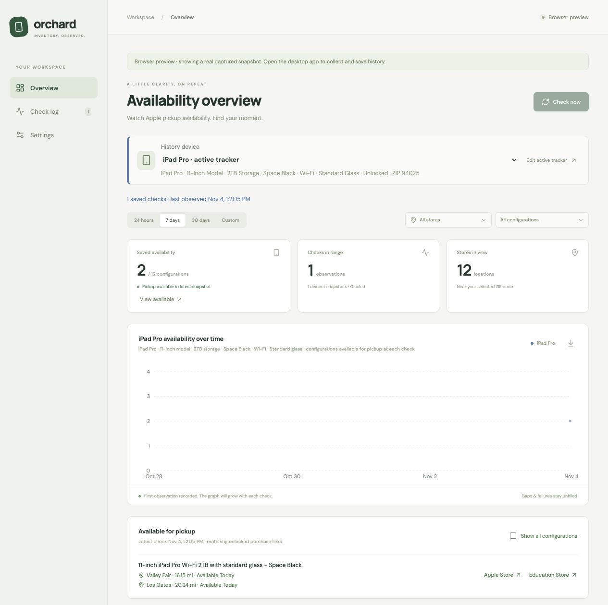
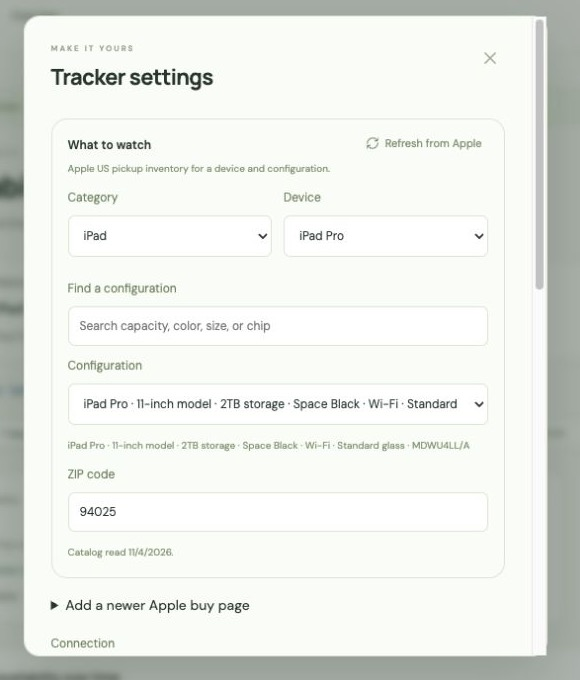

# Orchard

**Find an iPhone, iPad, or Mac available for pickup at a nearby Apple Store.** Orchard checks for you, keeps a local history, and can notify you when stock appears. You complete the purchase on Apple’s website.

**[Download the Mac app](https://github.com/ClancyDennis/orchard/releases/download/v0.2.1/Orchard_0.2.1_aarch64.dmg)** · [All downloads](https://github.com/ClancyDennis/orchard/releases/latest) · [First-time setup](#your-first-check) · [Codex / Claude Code](docs/agents.md)

Free and open source. No Orchard account or API key. **US Apple Stores only.** The downloadable app requires an **Apple Silicon Mac (M1 or newer), macOS 12 or later**. See [other platforms](#other-platforms-and-building-from-source) for current support.



*Orchard 0.2.1 browser preview, using one real observation from November 4, 2026. This is an interface example, not current stock. A new installation starts with an empty history.*

## Install on your Mac

You do **not** need Git, Node, Rust, or a terminal to use the downloadable desktop app.

1. Download **[Orchard_0.2.1_aarch64.dmg](https://github.com/ClancyDennis/orchard/releases/download/v0.2.1/Orchard_0.2.1_aarch64.dmg)**. On the Releases page, choose the `.dmg` under **Assets**. The `.tar.gz` is the separate command-line tool; **Source code** is for developers.
2. Open the downloaded `.dmg`, then drag **Orchard** into **Applications**.
3. Open **Applications → Orchard**. You can eject the disk image afterward.

**First-launch limitation:** this early release is not signed or notarized by Apple, so macOS may refuse to open it automatically. If the message says Apple cannot verify the developer and you trust this download, follow [Apple’s instructions for opening an app from an unidentified developer](https://support.apple.com/en-us/102445): after attempting to open it, look in **System Settings → Privacy & Security → Open Anyway**. On older macOS versions this is under **System Preferences → Security & Privacy**. Do not proceed if macOS reports malware or says the app will damage your computer. A managed work Mac may not permit unsigned apps.

To check your Mac type, open **Apple menu → About This Mac**. A **Chip** entry such as Apple M1, M2, M3, or M4 means Apple Silicon. An **Intel processor** cannot run this download.

## Your first check

On a fresh install, Orchard opens Settings. You can also open **Settings** from the sidebar at any time.

1. **Choose what you want.** Pick a **Category** and **Device**. Search **Find a configuration** for words such as `512GB`, `Star White`, or `16GB`, then select the exact **Configuration**. Choose **All configurations** if you are flexible. For an iPhone, choose **Unlocked** or your carrier.
2. **Enter your five-digit US ZIP code.** Orchard looks up nearby Apple Stores.
3. **Keep Connection on “Automatic Apple endpoints.”** You do not need to understand endpoints or open a browser session for normal use.
4. **Set a check rate and turn on Scheduled collection.** Start with **2 minutes**. Leave **Time windows** empty for one rate all day; add them later if you want different morning/evening rates. The schedule time zone is detected on first launch—leave it as detected if it matches your location.
5. **Enable Availability notifications if wanted, then click Save settings.** Allow notifications when macOS asks. The first check runs shortly afterward; the next check time appears in the overview.



*Configuration controls in the browser preview. Collection and saving settings require the installed desktop app.*

After a successful check, look under **Available for pickup** below the graph. A positive result lists the store and Apple’s pickup quote. Click **Apple Store** to continue on Apple’s site; **Education Store** opens the corresponding education-store link. Apple determines eligibility, price, and final availability. Orchard does not reserve stock or buy anything.

**Keep Orchard running and your Mac awake.** Closing its window keeps collection running in the menu bar. Quitting Orchard, putting the Mac to sleep, or closing a laptop lid normally stops checks until it is awake and running again.

## Understand what you see

| In Orchard | What it means |
|---|---|
| **Available for pickup** | Apple returned pickup availability at the stated observation time. Confirm it on Apple’s site before purchasing. |
| **0 available** after a successful check | None of the checked store/configuration combinations were available at that time. |
| **Unknown** or **failed check** | Orchard could not obtain a reliable answer. This does **not** mean the device is out of stock. |
| **Collector cooling down** | Apple rejected or limited requests. Orchard will retry at the displayed time; repeated clicks and restarts will not shorten the wait. |
| **Greyed-out device / Last seen available** | It was available earlier. This is historical information, not a current pickup offer. |
| **One dot or an empty graph** | There is little or no collected history yet. Keep the app running; Orchard cannot retrieve last week’s stock retroactively. |

The graph counts **store/configuration combinations**, not the number of physical devices in stock. Apple may say **Available Tomorrow** when a product can be ordered for pickup but the earliest pickup date is tomorrow.

## Browse a different device’s timeline

Use **History device** above the graph. The timeline, check log, store filters, patterns, and exports all follow that saved device/configuration/ZIP selection. iPhone, iPad, and Mac timelines have different colors and clear labels.

**Browsing history does not change what Orchard collects.** Use **Edit active tracker** or **Settings** to change the watched device. The desktop schedules **one device selection at a time**; that selection may include all its configurations. Other histories appear once that target has been checked, including checks made through the CLI or an agent.

## Common questions

**My device or configuration is missing.** Open Settings, select its category, and click **Refresh from Apple**. If Apple introduced a new family page, expand **Add a newer Apple buy page** and enter that Apple US buy-page URL. A failed refresh keeps the last good catalog. Standard Mac configurations are supported; custom-built combinations without a pickup part number are excluded.

**I see error 541 or 429.** Let the displayed cooldown finish. Use a two-minute rate as a starting point and avoid running several inventory tools on the same network. Switching connection methods does not provide extra request quota. Apple can still limit checks at any rate.

**Why are there no notifications?** Turn on **Availability notifications** in Orchard and try **Send test notification**. Also check **System Settings → Notifications → Orchard** and Focus/Do Not Disturb. Alerts are for newly available options; continuous availability is not announced on every check.

**Can I use it outside the US?** Not yet. This version uses US Apple Store pickup and five-digit US ZIP codes.

**Where is my history?** It stays on your computer. Settings shows the database location. Use the export buttons for CSV/JSON. Updating Orchard preserves its saved history and settings.

**Does the app need Chrome?** Normal direct checks do not. The optional browser connection and some fallback paths need installed Chrome, Edge, or Chromium. Keep Automatic selected unless you are troubleshooting.

**Still stuck?** Check **Check log** and **Settings → Apple connection**, then [open an issue](https://github.com/ClancyDennis/orchard/issues). Include your Orchard version, device, and error text. Do not upload cookies, account details, or your full database.

## Use with Codex, Claude Code, or a terminal

This is optional. The desktop app works by itself.

Orchard also provides a JSON command-line tool and an MCP server—an interface that lets an AI coding assistant list devices, check stock, and read saved history. They share the desktop’s local request limits and do not purchase products.

See **[agent and command-line setup](docs/agents.md)** for installation, example prompts, and tool responses.

## Other platforms and building from source

| Platform | Current support |
|---|---|
| **Apple Silicon Mac** | Downloadable desktop app and CLI; unsigned early release. |
| **Intel Mac** | No prebuilt download. Building from source may work, but has not been verified. |
| **Windows / Linux** | CLI and MCP tested in CI; install from source. Desktop packages are not provided or verified. |

Developers can build the desktop app with Node 22.13+, Rust stable, and [Tauri’s platform prerequisites](https://v2.tauri.app/start/prerequisites/):

```sh
git clone https://github.com/ClancyDennis/orchard.git
cd orchard
npm ci
npm run desktop
```

To build the CLI, run `cargo install --path crates/orchard-cli --locked` from the repository folder. For testing and architecture, see [Contributing](CONTRIBUTING.md) and [How Orchard works](docs/how-it-works.md).

[Security](SECURITY.md) · [MIT license](LICENSE)

Orchard is independent of Apple. Apple’s website is the final authority on price and pickup availability.
